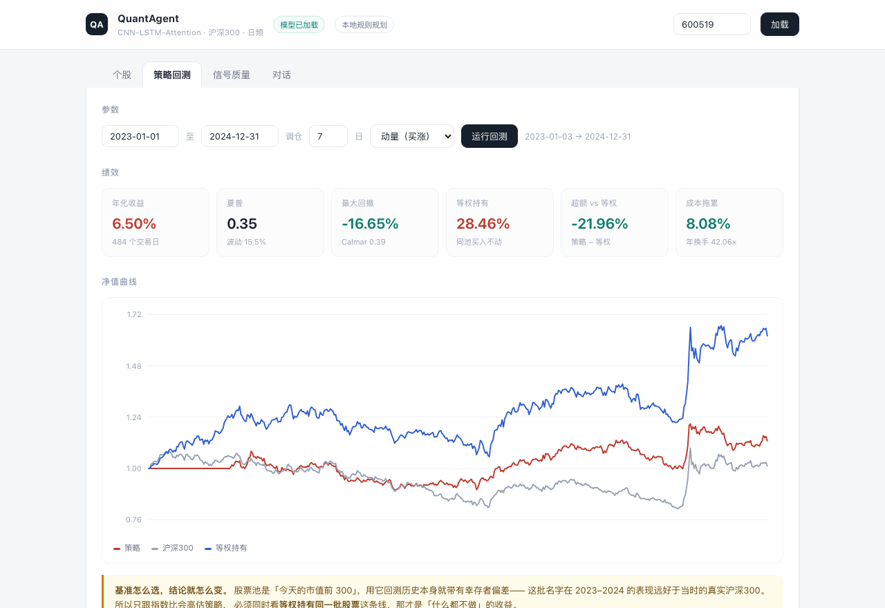
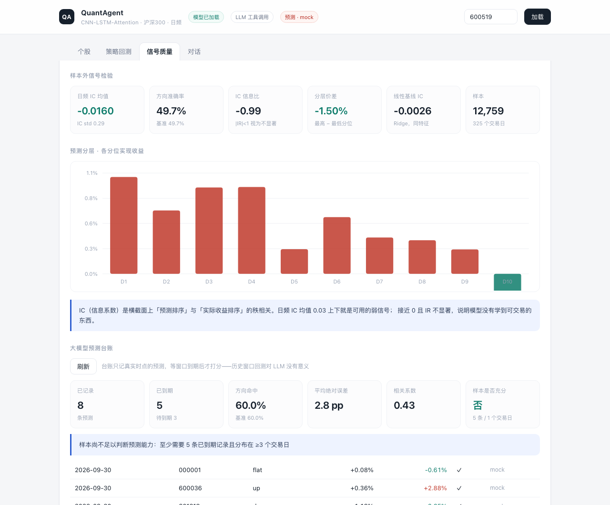
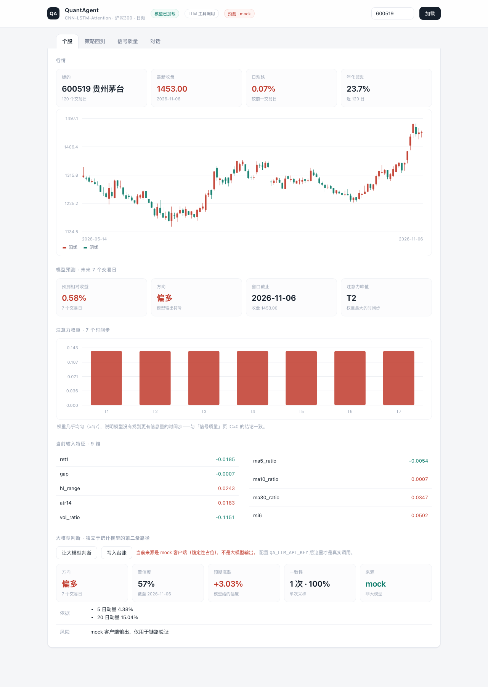

# QuantAgent

A daily-frequency research project for Chinese A-shares, with a CNN-LSTM-Attention baseline, strategy backtests and large language model (LLM) forecasts recorded in a prediction ledger.

[中文](README.md)

[](https://github.com/Leruo212/stock-quant-agent/actions/workflows/ci.yml)
[](https://leruo212.github.io/stock-quant-agent/)
[](pyproject.toml)
[](LICENSE)

Use it to compare model signals, price-volume strategies and basic benchmarks. The repository keeps the model's near-chance results, with information coefficient (IC) analysis, return buckets and backtest reports. This is a research project: the stock universe has survivorship bias, and LLM forecast quality still needs forward validation.

**[Try the demo](https://leruo212.github.io/stock-quant-agent/).** Charts and model outputs are build-time snapshots. Chat calls your selected model provider directly from the browser. The key is stored in localStorage; requests do not pass through this project's backend.



## Modules

| Module | Contents | Command |
|---|---|---|
| Data | Tencent → Sina → Eastmoney fallbacks, parquet cache, 9 features, date-based splits | `cli fetch` |
| Model | CNN-LSTM-Attention, 35,027 parameters, exportable attention weights | `cli train` |
| Backtest | Event-driven simulation, fees and slippage, strategy/index/equal-weight comparisons, Optuna search | `cli backtest` |
| Evaluation | Daily IC, return buckets, volatility groups, Ridge baseline and degradation checks | `cli evaluate` |
| Agent | Ten tools, a tool-calling loop, repeated forecast sampling and reflection | `cli agent` |
| Ledger | Append-only prediction records and scoring when outcomes become available | `cli ledger` |
| Frontend | FastAPI dashboard and a static GitHub Pages export | `cli serve` |

## Quick Start

Requires Python 3.10 or later. From the repository directory, create and activate a virtual environment:

```bash
python3 -m venv .venv
source .venv/bin/activate            # Windows PowerShell: .venv\Scripts\Activate.ps1
python -m pip install -e ".[dev]"
python -m quantagent.cli fetch
python -m quantagent.cli train
python -m quantagent.cli backtest
python -m quantagent.cli evaluate
python -m quantagent.cli serve      # http://127.0.0.1:8000
```

The first fetch needs network access. Cached data and model weights support the corresponding local analyses offline. New data acquisition and LLM calls still need a connection. A model checkpoint is included; market data is not distributed with the repository.

To run LLM forecasts:

```bash
export QA_LLM_API_KEY=your_api_key
python -m quantagent.cli forecast --code 600519 --samples 5 --reflect --record
python -m quantagent.cli forecast --codes 600519,000858,601318 --batch 8
python -m quantagent.cli ledger --score
```

## Results

### Model Signal

The validation segment contains 12,759 windows across 325 trading days.

| Metric | CNN-LSTM-Attention | Ridge baseline |
|---|---|---|
| Directional accuracy | 49.74% | 50.00% |
| Mean daily IC | -0.016 | -0.0026 |
| Annualised IC information ratio | -0.99 | -0.19 |
| Prediction standard deviation | 4.2e-06 | 1.1e-02 |

The network's directional accuracy matches always predicting up, and its predictions are nearly constant. Six configurations varying learning rate, batch size, window length, raw OHLCV inputs and ranking labels reached 49.51%–50.58% accuracy. The same-feature linear baseline also has near-zero IC. These runs do not show a stable predictive signal, but they do not establish that features alone are the bottleneck. LLM forecasts are a separate experiment to validate.

### Strategies

Seven-day rebalancing, long-only, equal-weight positions; costs include 8 basis points in fees and 2 in slippage.

| Period | Signal | Annualised | Sharpe | Max drawdown | CSI 300 | Equal-weight holding |
|---|---|---|---|---|---|---|
| 2023-01 → 2024-12 | Momentum | 6.50% | 0.35 | -16.65% | 0.63% | 28.46% |
| 2023-01 → 2024-12 | Reversal | 2.72% | 0.12 | -25.24% | 0.63% | 28.46% |
| 2025-01 → 2026-10 | Momentum | 30.04% | 1.72 | -8.66% | 3.90% | 36.86% |

Momentum beats the index but trails equal-weight holding. The universe uses the current top 300 stocks by market capitalisation, rather than historical constituents, so the backtest has survivorship bias. Comparing with the same-stock equal-weight benchmark exposes a limitation that an index-only comparison would miss. Annual turnover is about 42 times, with 8.08% cumulative cost drag in the reported run.



## LLM Forecast Experiment

The model receives a date-cut price-volume snapshot: momentum, moving-average deviations, RSI, ATR, volume ratios, range position and relative strength. Prompts request field names and values for each explanation. Snapshot tests check that changing future prices does not change the input snapshot.

- **Repeated sampling:** `--samples 5` requests five forecasts so their directions and estimated moves can be compared.
- **Forward records:** `--record` appends the prediction before its outcome is known. Records are deduplicated by `(code, as_of, provider, prompt_version)`.
- **Scoring:** after the seven-trading-day horizon, `ledger --score` reports hit rate, MAE, correlation and provider comparisons for available records.

```text
forecast --record → data/ledger/predictions.jsonl
                  → wait for the forecast horizon
ledger --score    → evaluate available outcomes
```

The recorded DeepSeek example used 773–848 tokens per individual forecast and about 448 per stock in batches of eight. Those are measurements of that run, not a general cost guarantee. See [LLM prediction notes](docs/LLM_PREDICTION.md).



### Static Demo

Market charts, baseline outputs and reports are exported to `docs/data/*.json` at build time. Chat runs in the browser against the selected provider, subject to that provider's cross-origin policy. The key is stored in localStorage, where same-origin scripts can read it; the page provides a clear-key control. For a local backend setup, use `serve` and environment variables.

```bash
make static
```

The Makefile uses `uv` and `.venv/bin/python` by default. Its `install` target requests Python 3.13; the manual installation above follows the package's Python 3.10+ requirement.

## Structure and Design

```text
quantagent/
  data/       Acquisition, caching, features and date-based datasets
  models/     CNN-LSTM-Attention
  llm/        Snapshots, prompts, forecasts, sampling and ledger
  backtest/   Simulation, metrics and parameter search
  evaluate.py IC, return buckets and degradation checks
  baseline.py Ridge comparison
  agent/      Tool loop and local intent planner
  api/        FastAPI endpoints
```

Cached market data can be reused locally; fetching and LLM calls remain network operations. Splits are by date, and normalisation statistics come from the training segment and are saved with the checkpoint. Reports compare strategies with both the index and equal-weight holding.

## Agent

```bash
python -m quantagent.cli agent "600519 未来一周的模型信号？"
```

Tools cover symbol search, prices, model signals, LLM forecasts, ledger scoring, universe scoring, momentum scanning, risk profiles, backtests and feature snapshots. With `QA_LLM_API_KEY`, a compatible model can select tools. Without a key, a deterministic local planner routes supported requests to tools. Prompts instruct the model to use tool-returned numbers and report missing data.

## Limitations

- The stock universe has survivorship bias; it is not reconstructed at each historical date.
- Evaluation uses one 80/20 split, without repeated walk-forward refitting.
- The simulator does not model trading halts or price-limit execution constraints.
- Example LLM forecasts do not establish predictive value. Available scored samples depend on the local ledger; check `ledger --score`.
- News and sentiment inputs are not implemented.

## Licence

[MIT](LICENSE) © M1r4th0R
