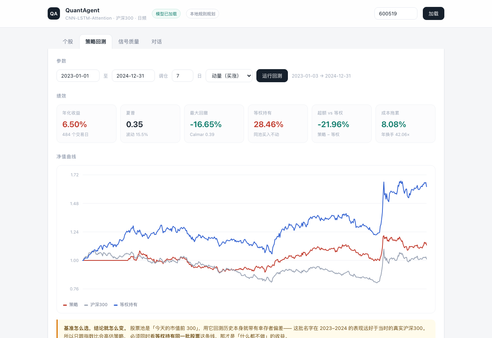
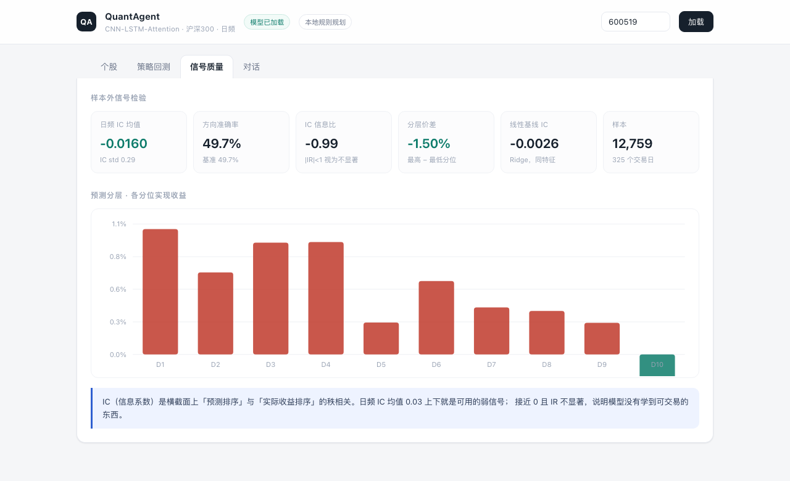
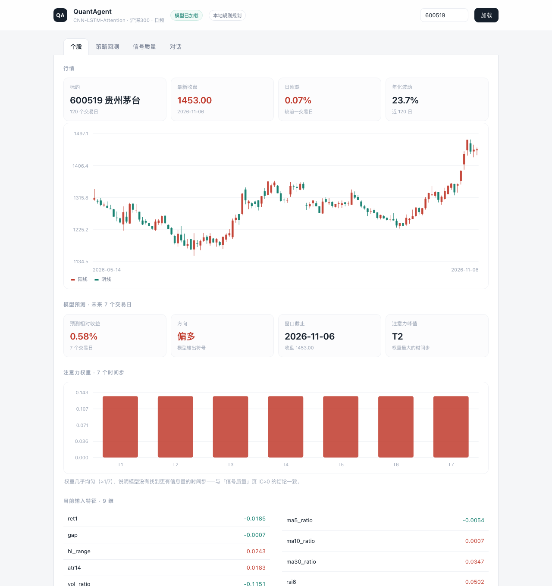

# QuantAgent

**把一份「基于深度学习的股票量化分析系统」的本科毕设，重建成一个结论可以被检验的系统。**

原论文报告的样本外方向准确率是 78.3%、策略年化 12.5%、夏普 1.12。我用同一套特征、同一个窗口长度、同一种网络结构重新实现了一遍，
结果是：**方向准确率 49.7%，IC -0.016，策略年化 6.5%，而且跑输了「什么都不做」。**

这个仓库的价值不在于复刻出一个更好看的数字，而在于把「为什么那些数字是假的」一条条摆出来，
并且留下了一条别人可以自己跑一遍的链路。



---

## 三个结论

| # | 结论 | 证据 |
|---|------|------|
| 1 | **模型没有学到东西** | 样本外方向准确率 49.74%，与"总是猜涨"的 49.74% 完全一致；日频 IC 均值 -0.016，IR -0.99（不显著）；同特征的线性基线 IC -0.0026。瓶颈不在网络容量，而在这 9 个价量特征于 7 日尺度上的信息含量 |
| 2 | **"跑赢指数"是幸存者偏差** | 策略年化 6.50%，沪深300 同期 0.63%，看着赢了 5.87%。但同一批股票**等权买入不动**是 28.46% —— 策略实际跑输 21.96 个百分点/年。股票池取的是「今天的市值前 300」，回测 2023 年时自动只包含活到今天还很大的名字 |
| 3 | **能跑通的是工程，不是 alpha** | 285 只股票、43.5 万行面板；三源容错取数；严格按日期切分训练/验证；含手续费与滑点的回测；IC / 分层 / 线性基线的信号检验；一层带工具调用的 Agent |

---

## 快速开始

```bash
make install                 # 建 venv 装依赖（默认走清华镜像）
python -m quantagent.cli fetch      # 抓行情 → 本地 parquet 缓存（约 40 秒 / 300 只）
python -m quantagent.cli train      # 训练 CNN-LSTM-Attention（CPU 约 1 分钟）
python -m quantagent.cli backtest   # 动量策略回测 → reports/
python -m quantagent.cli evaluate   # 信号质量检验（IC、分层、线性基线）
python -m quantagent.cli serve      # 打开 http://127.0.0.1:8000
```

一条命令跑完全流程：

```bash
python -m quantagent.cli pipeline --limit 300 --epochs 60
```

> 数据不随仓库分发（行情版权不属于我）。首次 `fetch` 需要联网，之后完全离线可复现。
> 模型 checkpoint 随仓库提供，`serve` 可以开箱即用。

---

## 结果

### 模型

| 指标 | 数值 | 怎么读 |
|---|---|---|
| 参数量 | 35,027 | 论文写 34,729，差 0.9%，见 [RESULTS](docs/RESULTS.md) |
| 训练 / 验证窗口 | 44,241 / 12,759 | 按日期切分，验证段是 2025-06-26 之后 |
| 验证 MSE | 0.005697 | 等于标签方差 0.005697 —— 也就是"永远预测均值"的成绩 |
| 预测标准差 | **4.18e-06** | 标签标准差 0.0755。模型输出了一个常数，R² = 0.0001 |
| 方向准确率 | **49.74%** | 基准（全猜涨）也是 49.74% |
| 日频 IC 均值 | **-0.016** | IR -0.99，\|t\|≈1，不显著 |
| 线性基线 IC | -0.0026 | 同样为零，说明不是网络的问题 |

先说清楚一件事：**CNN 实际上是塌缩了**。1.4 万条验证样本，预测值的标准差是 4×10⁻⁶，
注意力权重七步全是 0.1428。它在 MSE 上找到的最优解就是"别预测"。
这不是训练没调好——降学习率、换排序标签（cross-sectional rank）、加早停都试过，结论一样。

所以我又跑了一个 Ridge 线性基线，用完全相同的特征和切分。它的预测有真实方差，
IC 是 -0.0026，方向准确率 50.00%。**两条路都指向同一件事：这 9 个价量特征在 7 日尺度上没有可提取的信息。**
问题出在数据的信息含量，不在模型容量。

### 策略

区间 2023-01-03 → 2024-12-31，289 只标的，7 日调仓，含 8bps 手续费 + 2bps 滑点：

| 指标 | 策略 | 沪深300 | 等权持有同池 |
|---|---|---|---|
| 年化收益 | 6.50% | 0.63% | **28.46%** |
| 最大回撤 | -16.65% | -24.80% | -18.66% |
| 夏普 | 0.35 | — | — |
| 年换手 | 42× | — | 0 |
| 成本拖累 | 8.08%（累计） | 0 | 0 |

**换手 42 倍/年，光摩擦成本就吃掉 4 个百分点/年。** 这是短周期调仓策略最容易被忽略的成本，
也是论文里"未考虑交易税费"直接跳过的那一项。

把信号从动量换成反转（买跌得多的），结果更差（2.7% / 夏普 0.12）。也就是说，
在这个池子、这个频率上，主动选股本身是负贡献。



---

## 与论文的逐项对照

| 论文原述 | 本仓库 | 状态 |
|---|---|---|
| 预测准确率 78.3%，优于 ARIMA/SVM/RF 的 54.8%/59.6%/63.1% | 样本外方向准确率 49.74% | ❌ 无法复现 |
| 策略年化 12.5%，夏普 1.12，最大回撤 -18% | 年化 6.50%，夏普 0.35，回撤 -16.65% | ⚠️ 回撤接近，收益/夏普差一个量级 |
| 较传统 LSTM 策略提升 41% | 未构建对照 LSTM | ⬜ 未做 |
| BERT 情感分析带来 +5% 准确率 | 未实现 | ⬜ 未做（无稳定中文财经新闻源，且模型本身无信号，融合无意义） |
| 小波去噪（db4） | 未纳入主链路 | ⬜ 有意省略：全局小波滤波会让训练段与推理段分布不一致，且不改变结论 |
| 沪深300 全部 187 只成分股 | 市值前 300（今日口径） | ⚠️ 替代方案，引入幸存者偏差，已单独量化 |
| 5 万条/秒吞吐、99.93% 可用性、1000 并发 | 未做压测 | ⬜ 单机研究工具，压测数字无意义 |
| Flask + Vue + PostgreSQL + Redis + RabbitMQ + K8s | FastAPI + 单页前端 + parquet | ✅ 有意简化：原技术栈对负载量而言重了三个数量级 |
| 特征 9 维、窗口 7 天、CNN-LSTM-Attention | 一致 | ✅ 复现 |

完整推导、参数、复现命令见 [docs/RESULTS.md](docs/RESULTS.md)；架构取舍见 [docs/DESIGN.md](docs/DESIGN.md)。

---

## 架构

```
quantagent/
├── data/           行情：三源容错（腾讯 → 新浪 → 东财）+ parquet 缓存 + 特征工程
│   ├── tencent.py    日线主源，640 根/次向前翻页
│   ├── sina.py       股票池（市值前 N）+ 指数 / 兜底日线
│   ├── eastmoney.py  官方沪深300成分股，常被限流，仅作三级兜底
│   ├── features.py   9 维特征 + 前瞻标签
│   └── dataset.py    滑窗、按日期切分、z-score（统计量只来自训练段）
├── models/         CNN → PReLU → LSTM×2 → 注意力 → 全连接，35k 参数
├── backtest/       事件驱动回测、绩效指标、Optuna 十参数搜索
├── evaluate.py     IC / 分层收益 / 波动率分组 / 退化检测
├── baseline.py     Ridge 线性基线（回答"是不是网络不行"）
├── agent/          8 个工具 + 工具调用循环 + 无 key 时的本地规划器
└── api/            FastAPI，4 个 REST 端点 + 1 条 SSE 流
```

几个刻意的设计：

- **缓存是复现边界。** `data/cache/` 一旦存在，全链路零网络请求。
- **切分按日期，不按行。** 同一只股票相邻窗口高度相关，按行随机切分等于泄漏。
- **z-score 只用训练段统计量**，并写进 checkpoint，推理时复用。
- **基准要有三条线**（策略 / 指数 / 等权），只给一条的策略报告不值得信。

---

## Agent

`quantagent agent "600519 未来一周的模型信号？"`

8 个工具：搜索标的、查行情、模型预测、全市场打分、动量扫描、风险画像、策略回测、特征快照。

两种模式：

- **LLM 模式**：任意 OpenAI 兼容接口（DeepSeek / 通义 / Ollama…），模型自己决定调哪个工具。配 `QA_LLM_API_KEY` 即启用。
- **本地规划模式**：无 key 时的确定性兜底。按意图路由到工具，把数字渲染成中文结论。**clone 下来不配任何 key 就能跑。**

系统提示词里约束得比较死：所有数字必须来自工具返回，禁止把模型输出说成投资建议，
工具报错就直说缺什么。理由很实际——LLM 压在后测之上的典型失败模式，是自信地叙述它编造的数字。



---

## 隐私与合规

这是一个公开仓库，所以做了三件事：

1. **身份信息零残留。** 学号、真实姓名、导师、学校、个人邮箱域名一律不出现在代码与文档中。
   `scripts/privacy_check.py` 做两层扫描（字面词 + 邮箱/手机号/身份证/家目录正则），命中即 exit 1。
2. **数据不随仓库分发。** `.gitignore` 掉 `data/cache/`、`reports/*.csv`、`.env`。
   行情接口的数据版权不属于本项目，只提供取数脚本。
3. **密钥只走环境变量。** 仓库里只有 `.env.example`，没有任何真实 key。

```bash
python scripts/privacy_check.py   # 提交前跑一遍
```

本仓库仅用于研究与教学演示，所有输出为模型计算结果与历史统计，不构成投资建议。

---

## 已知局限

- **幸存者偏差未消除。** 股票池是「今天的市值前 300」，不是历史时点的成分股。这是本项目最大的方法缺陷，
  等权持有那条线就是它的量化：真实基准应该更接近 0.6% 而不是 28%。
- **没有做多期滚动验证。** 只切了一刀（80/20）。正确做法是 walk-forward，每次重新拟合。
- **不含涨跌停与停牌撮合限制**，实盘里 7 日调仓打到涨停板是买不进的。
- **没有新闻/舆情模态。** 原论文的多模态是核心卖点，这里只复现了数值分支。

这些不是"以后再说"，是写在这里让人先知道边界在哪。

---

## License

MIT © M1r4th0R
