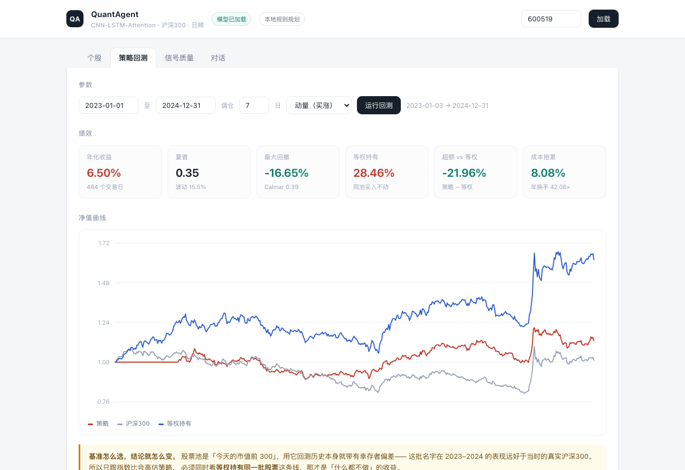
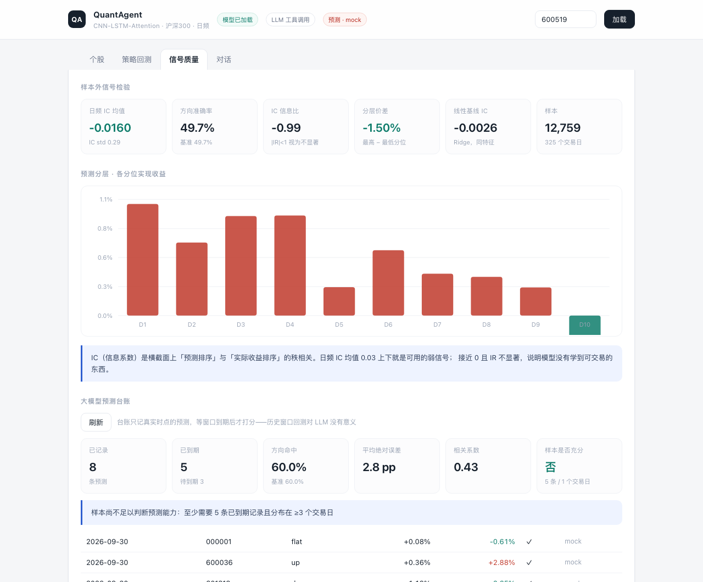
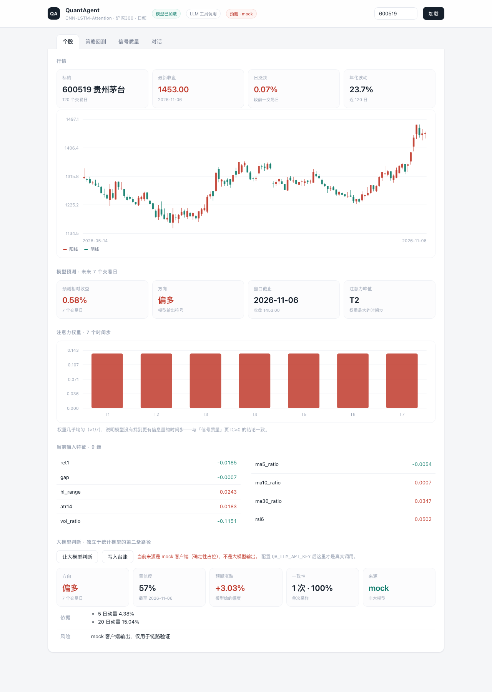

# QuantAgent

A 股日频量化研究项目，包含 CNN-LSTM-Attention 基线、策略回测，以及大语言模型（LLM / Large Language Model）预测与台账。

[English](README.en.md)

[](https://github.com/Leruo212/stock-quant-agent/actions/workflows/ci.yml)
[](https://leruo212.github.io/stock-quant-agent/)
[](pyproject.toml)
[](LICENSE)

用于比较模型信号、量价策略和简单基准。仓库保留了模型接近随机水平的结果，配有信息系数（IC / Information Coefficient）、分层检验和回测报告。当前是研究项目，股票池存在幸存者偏差，大模型预测效果仍需前向样本验证。

> **在线试用** → <https://leruo212.github.io/stock-quant-agent/>
> 无需安装。图表与模型预测为构建时快照；AI 对话用你自己的 API key 在浏览器里直连模型，
> key 保存在本机 localStorage，请求直接发给所选模型服务商，不经过本项目的后端。



---

## 目录

| 模块 | 内容 | 一行命令 |
|---|---|---|
| **数据** | 三级容错取数（腾讯 → 新浪 → 东财）、parquet 缓存、9 维特征、按日期因果切分 | `cli fetch` |
| **模型** | CNN-LSTM-Attention，35,027 参数，注意力权重可导出 | `cli train` |
| **回测** | 事件驱动、含手续费与滑点、三条基准线、Optuna 十参数搜索 | `cli backtest` |
| **评测** | 日频 IC / 分层收益 / 波动分组 / Ridge 基线 / 退化检测 | `cli evaluate` |
| **Agent** | 10 个工具 + 工具调用循环；LLM 预测带自一致性采样与反思轮 | `cli agent` |
| **台账** | append-only 预测记录，到期自动打分 | `cli ledger` |
| **前端** | FastAPI + 手写 SVG，零构建零 CDN；同源静态版可直接上 Pages | `cli serve` |

---

## 快速开始

需要 Python 3.10 或更新版本。在仓库目录中创建并激活虚拟环境后安装：

```bash
python3 -m venv .venv
source .venv/bin/activate            # Windows PowerShell: .venv\Scripts\Activate.ps1
python -m pip install -e ".[dev]"
python -m quantagent.cli fetch      # 抓行情 → 本地缓存（约 40 秒 / 300 只）
python -m quantagent.cli train      # 训练模型（CPU 约 1 分钟）
python -m quantagent.cli backtest   # 动量策略回测 → reports/
python -m quantagent.cli evaluate   # 信号质量检验
python -m quantagent.cli serve      # 打开 http://127.0.0.1:8000
```

接大模型做预测：

```bash
export QA_LLM_API_KEY=sk-...          # DeepSeek / 通义 / 月之暗面 / Ollama 任一兼容接口
python -m quantagent.cli forecast --code 600519 --samples 5 --reflect --record
python -m quantagent.cli forecast --codes 600519,000858,601318 --batch 8   # 批量，省约一半 token
python -m quantagent.cli ledger --score
```

> 首次 `fetch` 需要联网；已有缓存和模型权重时，可以离线运行相应的本地分析。
> 模型 checkpoint 随仓库提供。重新抓行情和调用大模型仍需网络，行情数据不随仓库分发。

---

## 结果

以下数字全部来自本仓库的脚本，样本外、含成本，可用文末命令重跑。

### 模型信号（样本外）

验证段 12,759 个窗口、325 个交易日。

| 指标 | CNN-LSTM-Attn | Ridge 基线 | 判读 |
|---|---|---|---|
| 方向准确率 | 49.74% | 50.00% | 与全猜涨的 49.74% 无区别 |
| 日频 IC 均值 | -0.016 | -0.0026 | 两者都接近 0 |
| IC 信息比（年化） | -0.99 | -0.19 | \|IR\| < 1，不显著 |
| 预测标准差 | 4.2e-06 | 1.1e-02 | 卷积网络收敛到常数 |

**当前实验的结果**：六组配置（学习率、batch、窗口 20、原始 OHLCV、排序标签）的方向准确率
均在 49.51%–50.58% 之间，同特征的线性基线 IC 也接近 0。这些实验没有显示出稳定的预测信号，
但不足以单独证明瓶颈只在特征。大模型预测是另一条待验证的实验路线。

### 策略

7 日调仓，全池做多，等权，含 8bps 手续费 + 2bps 滑点。

| 区间 | 信号 | 年化 | 夏普 | 最大回撤 | 沪深300 | 等权持有 |
|---|---|---|---|---|---|---|
| 2023-01 → 2024-12 | 动量 | 6.50% | 0.35 | -16.65% | 0.63% | 28.46% |
| 2023-01 → 2024-12 | 反转 | 2.72% | 0.12 | -25.24% | 0.63% | 28.46% |
| 2025-01 → 2026-10 | 动量 | 30.04% | 1.72 | -8.66% | 3.90% | 36.86% |

**为什么报告三条线。** 只跟指数比，动量策略"跑赢 5.87 个百分点"；但把同一批股票等权买入不动是
28.46%。股票池取的是今天的市值前 300，历史回测天然带幸存者偏差，指数基准把偏差藏了起来，
等权基准把它暴露出来。**单基准的回测报告没有解释力。**

成本项同样不省略：年换手 42 倍，8.08% 的累计成本拖累约等于 4 个百分点/年。



---

## 大模型预测

除统计模型外，仓库还提供大模型方向预测实验。输入是按预测日期截取的量价快照，
输出附字段引用、多次采样结果和预测记录，便于后续核对。

**1. 喂数字，不喂故事。** 提示词里没有可供发挥的语义实体，只有 18 个数字：5/20/60 日动量、
均线偏离、RSI、ATR、量比、60 日区间位置、相对沪深300 强弱。要求每条依据都引用字段名与数值，
**依据可以核对真假**。快照严格按 `as_of` 切片，测试里专门验证过"把之后的收盘价乘以 5，
快照必须一字不变"。

**2. 自一致性代替自我评估。** `--samples 5` 用同一提示词采样 5 次。方向一致率 100%、幅度极差
0.2pp，和一致率 60%、极差 5pp，是两种判断；模型自报的 confidence 分不出这两者。

**3. 前向台账代替历史回测。** 模型早已读过历史行情，在历史窗口上评估得到的是记忆不是推理。
所以每次真实时点的判断都写入 append-only 台账，等 7 个交易日真的过去再打分，并按
`(code, as_of, provider, prompt_version)` 去重。

```
forecast --record  →  data/ledger/predictions.jsonl
       ↓ 等窗口到期
ledger --score     →  命中率 / MAE / 相关系数 / 分 provider 对比
```

token 用量为实测（DeepSeek）：单只 773–848；批量 8 只均摊 448（省 47%）；同一天重复请求命中
本地缓存记 0。详见 [docs/LLM_PREDICTION.md](docs/LLM_PREDICTION.md)。



### 在线版是怎么做到的

GitHub Pages 只能托管文件，不能跑进程，所以拆成两半：

| 内容 | 在哪算 |
|---|---|
| K 线、模型预测、回测净值、信号报告 | 构建时预计算 → `docs/data/*.json` |
| 大模型对话 | 访客浏览器，直连模型厂商接口 |

浏览器能直连是因为 DeepSeek 允许跨域（预检返回 `access-control-allow-origin`），
所以不需要代理、也不需要后端。key 存 `localStorage`，只发给你填的那个接口，页面有「清除」按钮；
页面同时写明了这种模式的固有风险——同源脚本能读 localStorage。介意的话用 `serve` 本地跑，
key 就只在后端环境变量里。

```bash
make static     # 重新生成 docs/，会烘焙几条真实预测作为示例
```

---

## 架构

```
quantagent/
├── data/           行情：三级容错（腾讯 → 新浪 → 东财）+ parquet 缓存 + 特征工程
│   ├── tencent.py    日线主源，640 根/次向前翻页
│   ├── sina.py       股票池（市值前 N）+ 指数 / 兜底日线
│   ├── eastmoney.py  官方成分股列表，常被限流，仅作三级兜底
│   ├── features.py   9 维特征 + 前瞻标签
│   └── dataset.py    滑窗、按日期切分、z-score（统计量只来自训练段）
├── models/         CNN → PReLU → LSTM×2 → 注意力 → 全连接，35k 参数
├── llm/            大模型预测：快照构造、提示词、JSON 校验、自一致性、反思、台账
├── backtest/       事件驱动回测、绩效指标、Optuna 十参数搜索
├── evaluate.py     IC / 分层收益 / 波动率分组 / 退化检测
├── baseline.py     Ridge 线性基线
├── agent/          10 个工具 + 工具调用循环 + 无 key 时的本地规划器
└── api/            FastAPI，6 个 REST 端点 + 1 条 SSE 流
```

几个刻意的设计：

- **缓存用于复用行情。** 已缓存的数据可供本地实验复用；抓取新数据和调用大模型仍需网络。
- **切分按日期，不按行。** 同一只股票相邻窗口高度相关，按行随机切分等于泄漏。
- **z-score 只用训练段统计量**，并写进 checkpoint，推理时复用。
- **基准要有三条线**（策略 / 指数 / 等权），只给一条的策略报告不值得信。

---

## Agent

`python -m quantagent.cli agent "600519 未来一周的模型信号？"`

10 个工具：搜索标的、查行情、统计模型预测、大模型预测、台账打分、全市场打分、
动量扫描、风险画像、策略回测、特征快照。

两种模式：

- **LLM 模式**：任意 OpenAI 兼容接口，模型自己决定调哪个工具。配 `QA_LLM_API_KEY` 即启用。
- **本地规划模式**：无 key 时的确定性兜底，按意图路由到工具并渲染结论。
  **clone 下来不配任何 key 就能跑。**

系统提示词里约束最严的是数据来源：所有数字必须来自工具返回，禁止把模型输出说成投资建议，
工具报错就直说缺什么。理由很实际——LLM 压在后测之上的典型失败模式，是自信地叙述它编造的数字。

## 已知局限

- **幸存者偏差未消除。** 股票池是「今天的市值前 300」，不是历史时点成分股。这是本项目最大的
  方法缺陷，等权基准那条线就是它的量化——真实基准应该更接近 0.6% 而不是 28%。
- **没有做多期滚动验证。** 只切了一刀（80/20）。正确做法是 walk-forward，每次重新拟合。
- **不含涨跌停与停牌撮合限制**，实盘里 7 日调仓打到涨停板买不进。
- **大模型效果尚待前向验证。** 台账支持记录与到期评分，但示例预测不足以证明有效性；
  实际可评分数量以本地 `ledger --score` 的输出为准。
- **没有新闻/舆情模态。** 多模态是明确的下一个方向，但需要稳定数据源。

---

## License

[MIT](LICENSE) © M1r4th0R
